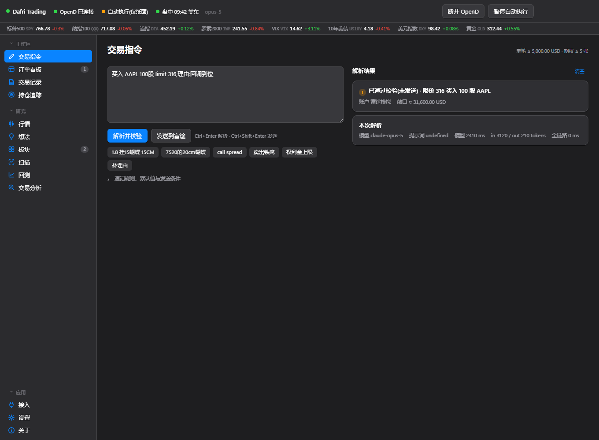
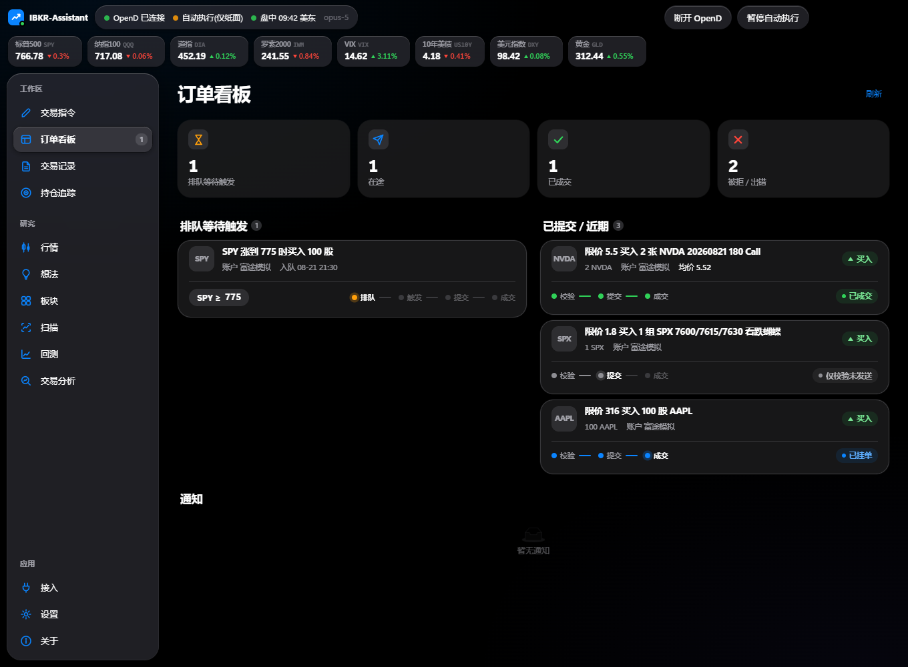
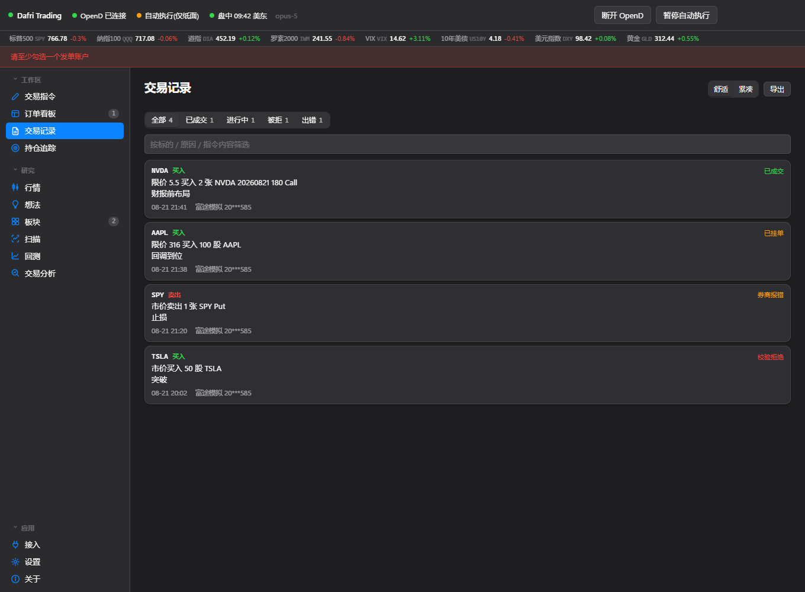
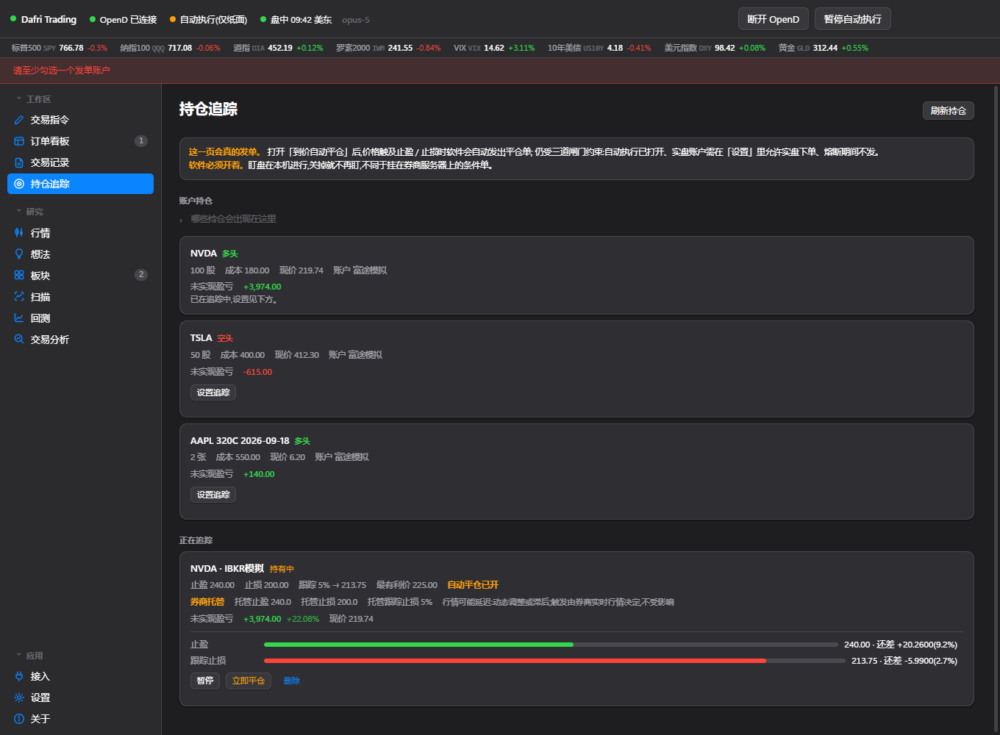
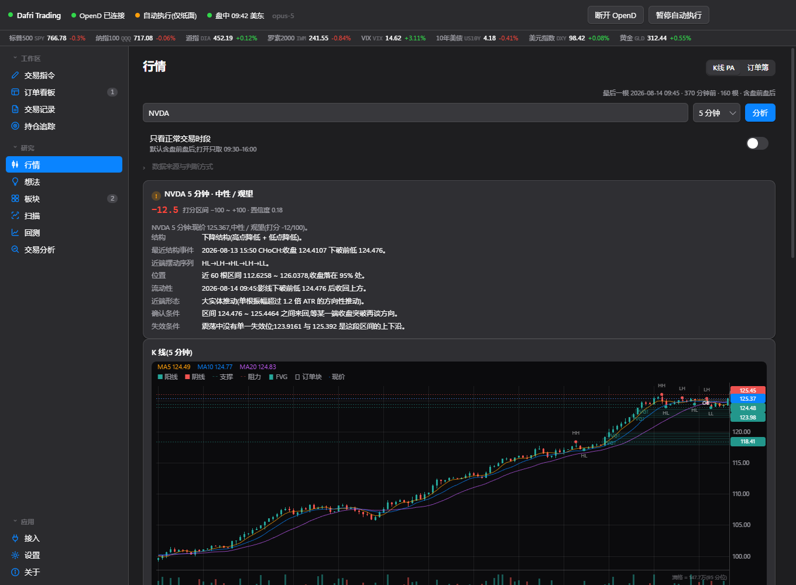
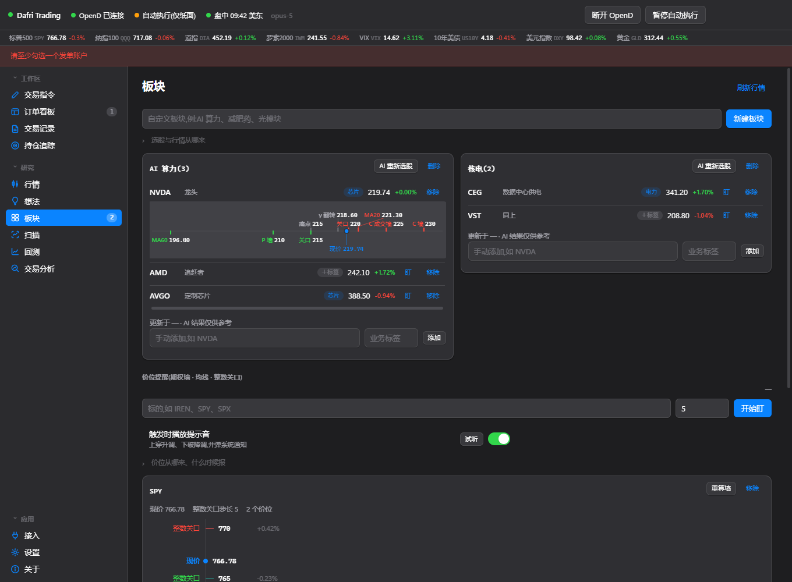
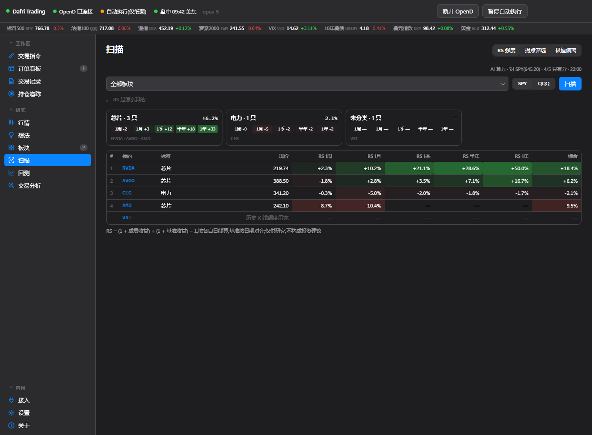
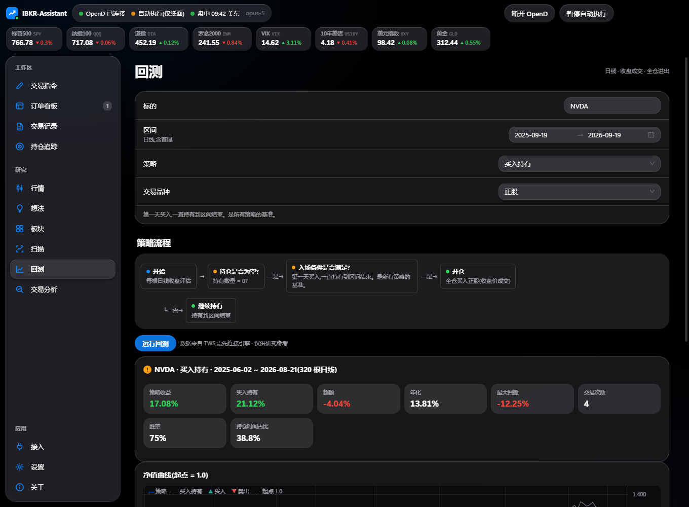
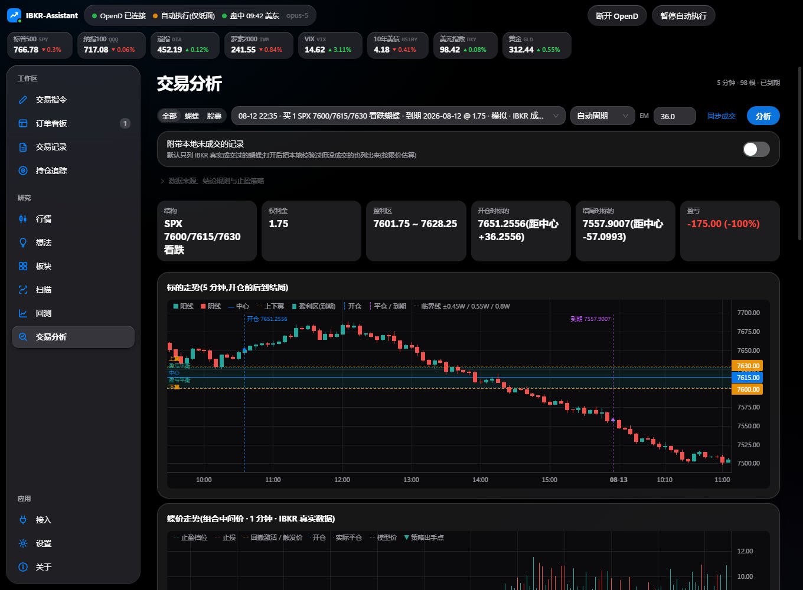

# Datrix

用自然语言下单到 Interactive Brokers 的桌面交易台。大模型只负责把"买入 AAPL 100 股 limit 230,理由:回调到位"这样的中英混合指令翻译成结构化订单;限额、方向、账户、价差结构、时段、重复单的校验全部由代码完成,再经三道执行闸门才会发到券商。围绕下单之外,还带持仓追踪自动平仓、K 线价格行为分析、期权墙价位提醒、板块扫描、回测与交易复盘。

[](https://github.com/Dafrix69/IBKR-Assistant/actions/workflows/ci.yml)

[](LICENSE)

> **分支**:`qt` 是主线,只有 Qt 6 / C++ 版(`native/`,见 [native/README.md](native/README.md))。Electron 版与 TypeScript 引擎已从这条线删掉;
> 它们留在 `main`(已发布的 0.5.x)与 `archive/electron-final-2026-10-22`(删之前最后一份本地改动),不再开发。

> 本仓库是软件实现,不构成任何投资建议。自动执行意味着解析错误会真金白银成交,请先在模拟账户跑够回归再考虑实盘。

**使用者**从 [用户手册](docs/user-guide/README.md) 看起;每一版改了什么在 [更新记录](CHANGELOG.md);
发现安全问题请按 [SECURITY.md](SECURITY.md) 私下报告。



## 功能

每个功能的设计与规则在 [docs/features](docs/features/README.md)。

**交易指令** 一句话下单:正股、期权、垂直价差、蝴蝶、铁鹰、条件单。SPX 蝴蝶行话(`1.8 挂15蝴蝶 15CM`)在本地解析,约 2 毫秒;其余交给大模型(Anthropic Claude 或任意 OpenAI 兼容端点),结构化输出之后由代码复校验。可以勾选多个账户,每个账户各发一份、各自校验。见 [交易指令](docs/features/instruction.md)、[双账户发单](docs/features/dual-account.md)。

**校验与闸门** 限额、方向、价差结构、账户、交易时段、重复单全部由代码逐条复算;「允许自动执行」与「允许实盘账户下单」默认关闭;连续失败自动熔断,手动熔断撤掉全部挂单。被拦下的单说明是谁拒的(模型、校验、引擎、券商)、为什么、去哪里打开。真实账号不进提示词。

**蝴蝶测算** 开仓之前填上一只蝶、预计标的走到的价位和时刻,按各腿的 IV 算出到时值多少、赚多少;到时的 IV 用两年多历史数据校准的模型估计,结果附「半数情况下」的区间与「IV 不变」的数。只计算,不下单。见 [蝴蝶测算](docs/features/fly-plan.md)。

**保护规则 · 执行对账 · 风险预算** 接连止损、回撤过大、日内亏损到线、同一标的刚平仓时暂停新单,只挡新单、不挡平仓,到点自己解除,默认全关。重启或重连之后,引擎把券商侧的在途单与成交对回本地记录,两边都查不到的标「去向不明」,不替你作废。一单占账户权益太多时只提醒。见 [保护规则](docs/features/protections.md)、[执行对账](docs/features/reconcile.md)、[单笔风险预算](docs/features/risk-budget.md)。

| 订单看板 | 交易记录 |
|---|---|
|  |  |

**订单看板 / 交易记录** 排队中的条件单、已提交订单、通知流;记录是只增的 SQLite(触发器禁止改删),状态、成交、佣金、盈亏按事件追加,可导出 JSON。



**持仓追踪** 对持仓设止盈、止损、跟踪止损、利润回撤(可按浮盈分档、尾盘收紧),或只填标的目标价("SPX 到 7740 就走"),由引擎按各腿的波动率每秒换算成持仓该值的价;期权与组合还能填标的止损价("SPX 跌到 7700 就走"),只看标的现价。触发后引擎发出平仓单,挂在各腿买卖价合成的立刻成交价上,没成交就逐秒让价;也可以托管到券商侧挂 GTC 单,由引擎每秒改价。盯盘在本机,软件必须开着。见 [持仓追踪](docs/features/tracker.md)。



**行情** 1 分钟到日线的实时 K 线,代码计算摆动结构、BOS / CHoCH、关键位、FVG、扫单、K 线形态,给出 −100 到 +100 的分与确认、失效条件,权重公开;图下是这个标的的盘口,页面下半可以同时关注 12 个盘口。见 [行情](docs/features/priceaction.md)。



**板块 · 价位提醒 · 异动** 输入主题由 AI 选出成分股。每只股两个开关:盯价位(期权墙、均线、52 周高低、整数关口,穿越时提醒;短期内反复碰同一条日均线也提醒)、盯异动(放量、急涨急跌、大涨大跌)。提醒用不抢焦点的置顶弹窗。见 [期权墙与价位提醒](docs/features/optionwall-alerts.md)、[反复碰均线](docs/features/ma-touch.md)、[股票池](docs/features/quality-watch.md)。



**扫描** 股票池一次扫完:RS 强度、各周期的 MACD 背离、极值偏离合成一张表;下面是强势股筛选(Minervini 趋势模板与 VCP、RS 评级、大盘方向)。见 [强势股筛选](docs/features/leaders.md)。



**回测** 五种策略,日线收盘出信号、下一根开盘成交,全仓进出,只作研究;可以扣每边成交成本,参数扫描看样本外与滚动前推。见 [回测:成交口径、统计、期权估价与参数扫描](docs/features/backtest-lab.md)。



**交易分析** 蝴蝶由 IBKR 逐笔成交合成并复盘,回放止盈策略;股票按一段持仓复盘进出场位置、最大浮盈浮亏与兑现率。见 [交易分析](docs/features/tradereview.md)。

**绩效体检** 全部已了结交易的美元账本:胜率、盈亏比、期望值、R 与 SQN、回撤,按写死的规则挑出行为上的毛病;另有执行损耗、保护规则建议、分享卡片、信号成绩单。本机计算,不调模型。见 [绩效体检](docs/features/performance.md)、[信号成绩单](docs/features/signal-scorecard.md)。

**数据与安全** 交易库每天与升级之前自动备份,可以从界面恢复;配置或库坏了时给出恢复的路;发单、开闸门、放宽限额要经主进程的原生确认;发单超时报「结果未知」;日志落盘前脱敏,可以导出诊断信息;首次启动先看风险揭示与条款。见 [数据与配置的保险](docs/features/durability.md)、[确认凭据](docs/features/confirm-grants.md)、[日志脱敏与诊断信息](docs/features/diagnostics.md)、[条款同意](docs/features/consent.md)。

**其他** 想法备忘与知识总结、下单页的历史相似交易、顶栏宏观行情带(标普、纳指、VIX、美债 10Y、纽约金、布油、比特币)、TWS 连接检测与自动重连、OpenD 的进程与端口检测、新版本检查。界面是 Liquid Glass 风格,深浅色默认跟随系统,涨跌配色与玻璃透明度在「设置」里调。

## 它怎么工作

```
Datrix(Qt 6 / QML 界面)──stdio JSON-RPC──▶ 交易引擎 ibkr-engine(C++ 子进程)──▶ TWS / IB Gateway(127.0.0.1)
   发起方只有界面自己                         ├─ 解析:本地速记 → 大模型                ├─ 富途 OpenD(桥待真机联调)
   敏感操作原生确认                            ├─ 校验层 → 三道闸门 → 下单层             └─ 公开数据源(指数、宏观)
                                              └─ append-only SQLite + 熔断文件
```

- 引擎与界面之间没有监听端口,只有 stdio。RPC 分三条道:本地读写即来即答,行情类读请求并发,下单类请求严格顺序。
- 下单、改限额、连券商要经界面进程的原生确认。
- API Key 与富途解锁密码存系统凭证库(macOS Keychain / Windows 凭据管理器),不落配置文件。
- 引擎行为由 `native/spec/baseline/` 里的录制基线(96 步 RPC 回放)与 `native/tests/` 的 QtTest 钉着,全部离线。

## 安装

[Releases](https://github.com/Dafrix69/IBKR-Assistant/releases) 里现有的安装包是 Electron 版(0.5.x,`main` 分支)。Qt 版还没有安装包,
现在从源码编(见下一节)。

**运行前提**

1. IBKR 的 TWS 或 IB Gateway 已登录并打开 API(默认模拟账户端口 7497,实盘 7496)。建议先只用模拟账户。
2. 一个大模型 API Key:Anthropic,或任意 OpenAI 兼容端点。
3. 首次启动先读风险揭示与条款;之后按「交易指令」页上的就绪清单走:在「接入 → 大模型」填 Key,在「接入 → 账户」填上自己的账号,
   在「接入 → TWS」检测连接,在「设置」核对限额与开关。逐步的图文见 [用户手册 · 安装与首次配置](docs/user-guide/01-安装与首次配置.md)。

同一 IBKR 用户名在别处登录时,行情会跟着那边走,本机会拿不到 K 线;先在别处登出。

## 从源码运行

```bash
git clone https://github.com/Dafrix69/IBKR-Assistant.git datrix && cd datrix
brew install qtbase qtdeclarative qtwebsockets qtsvg qttools cmake ninja
cd native && cmake --preset mac-debug && cmake --build --preset mac-debug && ctest --preset mac-debug
```

编出来的应用在 `~/Library/Caches/IBKR-Assistant/native-build/mac-debug/app/` 下;它默认拉同一次编出来的 C++ 引擎、用仓库里的
`config/settings.json`。VS Code 里怎么改、编、调,以及只看界面不连券商的几种开法,见 [native/README.md](native/README.md);
改代码的规矩在根目录的 [CLAUDE.md](CLAUDE.md)。

命令行也能用同一个引擎:`ibkr-engine selftest | validate | records | import-fills …`。

## 配置

`config/settings.json`(从 `settings.example.json` 生成,含账户映射,永不进仓库):

| 段 | 说明 |
|---|---|
| `limits` | 单笔名义金额、期权张数、市价单股数、最小置信度、价差滑点、重复单窗口 |
| `policies` | `auto_execute`、`allow_live_trading`、触发价复核、休市市价单策略、连续失败熔断阈值 |
| `protections` | 保护规则:止损护栏、回撤护栏、同标的冷却、日内亏损上限。默认全关,只挡新单、永不挡平仓,到点自己解除 |
| `risk_budget` | 单笔风险预算:按账户填权益,期权最坏亏损 / 股票名义金额占比超线时在订单上提醒,不拦单。默认关 |
| `connections` / `accounts` | TWS 端口与 client id;账户别名 → 真实账号,`is_paper` 决定实盘闸门。账户可以在「接入 → 账户」里配;连接只能手改 |
| `market_holidays` / `early_close_days` / `market_calendar` | 临时休市写在这里;规则算得出来的假日由内置日历补上(`config_only` 退回只认配置) |
| `symbol_aliases` / `index_symbols` | 「苹果 → AAPL」这类别名;SPX 的交易所与交易类 |
| `prompt_version` | 提示词版本,`prompts/` 下按版本号只增不改,一行回滚;`latest` = 跟着软件带的最新一版走 |

每一段配置背后的规则写在对应的功能文档里,目录见 [docs/features](docs/features/README.md)。

出问题要现场:界面进程与引擎 stderr 都写进一份滚动日志 `main.log`(单份 4 MB;macOS 在 `~/Library/Logs/Datrix/`,Windows 在 `userData/logs/`),落盘前抹掉账号、密钥与用户名。路径在「关于」页;「关于 → 支持 → 导出诊断信息…」把它连同版本、引擎状态、脱敏后的配置收成一份可以直接发出去的文件。

## 仓库布局

| 目录 | 内容 |
|---|---|
| `native/` | Qt 6 / C++ 版:`engine/` 交易引擎、`shell/` 界面进程里不画界面的那一半、`app/` QML 界面、`spec/` 引擎与界面的契约类型和录制基线、`tests/` QtTest、`tools/` |
| `prompts/` | 提示词资产,按版本号只增不改 |
| `config/` | `settings.example.json` |
| `docs/` | `user-guide/` 用户手册、`legal/` 条款文本、`features/` 功能文档、`journal/` 事故记录、`briefs/` 与 `reports/` 历史文档、`screenshots/`、`release-checklist.md` |

## 状态

以下是 Electron 版时核对过的情况;C++ 引擎是照它逐模块搬的,**还没有在真机 TWS 上跑过**,真机上的每一条都要重新核对。

- IBKR 通道在模拟账户上真机核对过:连接、下单、状态与成交回报、佣金、撤单、熔断;托管蝴蝶止盈单的秒级原地改价、重启认领、成交落闩。
- 追价平仓(让价节奏、非托管平仓单改价、部分成交后改总量)目前只有离线测试,尚未在真机上核对。
- 执行对账(重启 / 重连后认领在途单)与保护规则(止损护栏、回撤护栏、同标的冷却、日内亏损上限)目前只有离线测试,尚未在真机上核对。
- 执行损耗、单笔风险预算、信号记录(2026-09-26 加的)目前只有离线测试;信号成绩单要攒够信号才有结论。
- 2026-09-27 做过一轮钱路径审计(下单校验、速记解析、持仓追踪与追价、托管单、回报落库、执行对账、保护规则、桌面端),
  修掉 30 多处会让一张单变成另一张单、或让持仓失去保护的问题,每处都有先红后绿的离线回归测试;
  改动后的规则写在各自的功能文档里(持仓追踪「熔断与已有的保护」「立即平仓」两节、交易指令、保护规则、执行对账、双账户)。
  这些改动同样只有离线测试,在模拟账户上核对过托管 / 立即平仓 / 熔断之后再上实盘。
- 2026-09-28 做了一轮商用准备(钱路径上几处只在异常时刻才暴露的漏洞、数据的备份与恢复、确认凭据、日志脱敏与诊断信息、
  条款确认、从界面配置账户、打包加固、发版闸门),做了什么、还差什么、哪些要你来定,见
  [docs/reports/commercial-readiness-2026-09-28.md](docs/reports/commercial-readiness-2026-09-28.md)。
  这些改动同样只有离线测试;打包相关的(Electron 41、熔断丝、签名版权限、安装器)要实际打一次包才验证得了。
- 富途 OpenD 通道:进程检测与端口探测可用;握手诊断、连接与下单在适配桥完成真机核对之前不可用;接口库 `futu-api` 不随安装包发出去。
- 安装包没有开发者证书:Windows 未签名,macOS 是 ad-hoc 签名。Developer ID 签名与公证的路已经接好
  (`dist:mac:signed`、CI 的 Secrets),证书到手之前发出去的仍是 ad-hoc 包。

## 许可证

[MIT](LICENSE)。可以自由使用、修改、再分发(包括商用),保留版权与许可声明即可。软件按"原样"提供,不附带任何担保;
用它下单产生的盈亏与风险由使用者自己承担。应用首次启动时展示的风险揭示、使用条款与隐私说明在 [docs/legal](docs/legal)
(草稿,未经律师审阅)。

依赖各自沿用原来的许可证,不因本项目改变:Qt 6(LGPL-3.0,动态链接)、SQLite(公有领域,`native/third_party/sqlite3`)。
