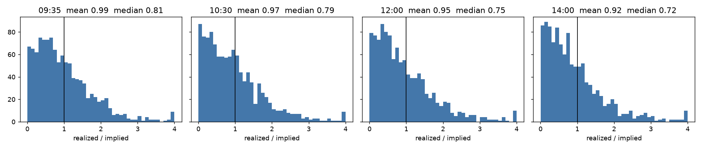
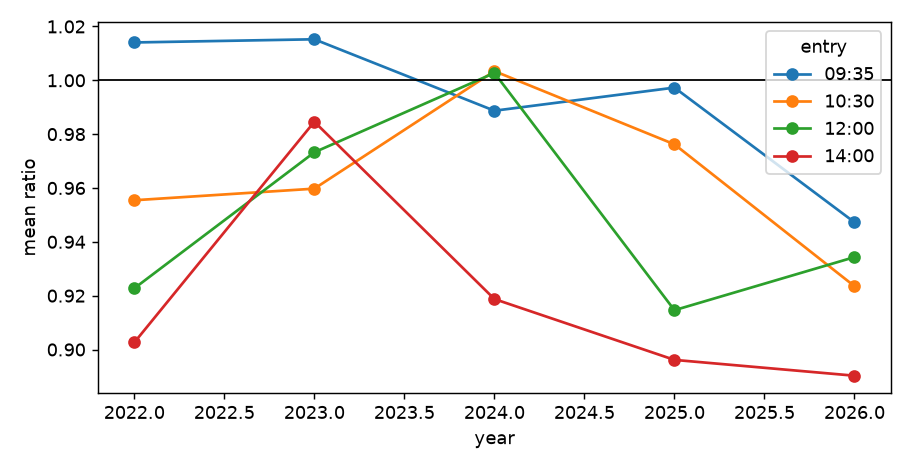
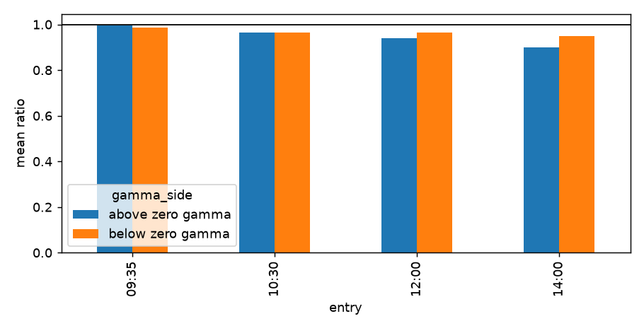

# Step 2 边际研究

样本：2022-05-02 到 2026-10-29，1118 个交易日（去掉 9 个半天交易日和 2 天没有 0DTE 的日子），4 个入场时点。这里只研究隐含与实际，不是回测。全部表格在 `reports/step2_tables/`。

## 三个问题的答案

**(a) ratio 整体是否 < 1？** 很轻微，而且越晚越明显。只有 14:00 的均值在统计上显著小于 1（0.92，95% 区间 0.875–0.972）。09:35 是 0.99，基本公平。

**(b) 哪些 regime 显著 < 1，哪些 ≥ 1？** **没有找到稳定的 regime 过滤器。** 最关键的 GEX 表没有显著差别：按入场时的现货分零 gamma 之上和之下，ratio 差值都不超过 0.05，95% 区间全部跨过 0。14:00 的 25 宽蝶在零 gamma 之上看起来更好，但这个差距几乎全部来自 2026 年，2024、2025 年方向相反。

**(c) ±25 / ±50 哪个更贴合落点？** ±25 更贴合。实际落在 ±25 内的概率比 BS 高 2–3 个百分点，±50 在 14:00 已经没有优势，±75 约等于 BS。按蝶的中间价算，14:00 的 25 宽边际最高，占中间价 4.6%，但 09:35 入场是负的。

**一句话**：0DTE ATM 蝶的边际存在但很小（扣成本前约占蝶中间价 2–5%），主要靠入场时间，不靠 regime。

## 3.1 隐含 vs 实际

`ratio = |官方收盘 − 入场现货| / ATM 跨式中间价`。BS 下 ATM 跨式约等于 E|波动|，所以均值 1 就是公平。

| 入场 | n | 均值 | 95% 区间 | 中位数 | P90 | ratio < 1 占比 | 跨式卖方（点，扣成本前） | 平均隐含（点） |
|---|---|---|---|---|---|---|---|---|
| 09:35 | 1118 | 0.993 | 0.946–1.041 | 0.814 | 2.00 | 59.6% | +0.36 | 30.4 |
| 10:30 | 1118 | 0.966 | 0.917–1.018 | 0.792 | 1.95 | 61.0% | +0.95 | 25.8 |
| 12:00 | 1118 | 0.952 | 0.905–1.002 | 0.747 | 1.99 | 62.9% | +1.02 | 21.1 |
| 14:00 | 1118 | 0.921 | 0.875–0.972 | 0.720 | 1.94 | 64.5% | +1.41 | 15.7 |

中位数明显低于均值：大多数日子波动比隐含小，少数大行情日子把钱赚回去。P90 约为 2 倍隐含，右尾在四个时点都一样粗。**这就是蝶胜率高但不一定赚钱的原因。**

### 按年份

| 年份 | 天数 | 09:35 | 10:30 | 12:00 | 14:00 |
|---|---|---|---|---|---|
| 2022 | 166 | 1.014 | 0.955 | 0.923 | 0.903 |
| 2023 | 248 | 1.015 | 0.960 | 0.973 | 0.985 |
| 2024 | 249 | 0.989 | 1.003 | 1.003 | 0.919 |
| 2025 | 247 | 0.997 | 0.976 | 0.915 | 0.896 |
| 2026 | 208 | 0.947 | 0.924 | 0.934 | 0.890 |

方向大体一致，但 2023、2024 的部分时点接近 1。单年的区间都很宽，只有 2025 的 14:00 显著。

### 按前日 VIX 五分位

| | 09:35 | 10:30 | 12:00 | 14:00 |
|---|---|---|---|---|
| Q1 低 | 0.967 | 0.962 | 1.029 | 0.957 |
| Q2 | 1.020 | 0.982 | 0.929 | 0.936 |
| Q3 | 0.950 | 0.928 | 0.853 | 0.884 |
| Q4 | 1.056 | 1.006 | 0.995 | 0.916 |
| Q5 高 | 0.969 | 0.951 | 0.954 | 0.911 |

没有单调关系。Q3 在 12:00、14:00 显著小于 1，但相邻的 Q2、Q4 不支持，更可能是偶然。

### 按事件

| 事件 | 天数 | 09:35 | 10:30 | 12:00 | 14:00 |
|---|---|---|---|---|---|
| 无事件 | 875 | 0.982 | 0.962 | 0.956 | 0.915 |
| CPI | 52 | 0.953 | 0.950 | 0.861 | 0.885 |
| 非农 | 50 | 1.098 | 1.098 | 0.875 | 0.868 |
| PCE | 52 | 1.173 | 1.093 | 1.118 | 1.047 |
| FOMC | 37 | 1.013 | 0.997 | 1.013 | 1.059 |
| 月度 opex | 35 | 1.009 | 0.813 | 0.869 | 0.910 |
| 季度三巫日 | 17 | 0.729 | 0.678 | 0.786 | 0.788 |

事件重叠时按 FOMC、CPI、非农、PCE、三巫、opex 的顺序归入一类。

- **FOMC 下午没有边际**：12:00 和 14:00 的 ratio 都 ≥ 1，这和 14:00 决议一致，14:00 入场等于直接吃决议。区间很宽（14:00 为 0.72–1.50），只能算方向性证据。
- **PCE 意外偏高**：09:35 是 1.17（0.98–1.37）。没有明显的经济学解释，很可能是样本噪声，不建议直接采用。
- **三巫日明显偏低**：09:35、10:30 显著小于 1，但只有 17 天。
- **CPI 没有不利影响**：CPI 在开盘前发布，入场时已经被价格吸收。

### 按前日涨跌（±1%）

| | 天数 | 09:35 | 10:30 | 12:00 | 14:00 |
|---|---|---|---|---|---|
| 大跌 | 135 | 0.915 | 0.877 | 0.984 | 1.020 |
| 平 | 826 | 1.016 | 0.992 | 0.961 | 0.918 |
| 大涨 | 155 | 0.941 | 0.916 | 0.881 | 0.842 |

大涨后的下午最好，大跌后的下午没有边际。样本不大，需要在 Step 3 的样本外验证。

### 按星期

| | 09:35 | 10:30 | 12:00 | 14:00 |
|---|---|---|---|---|
| 周一 | 0.877 | 0.872 | 0.955 | 0.904 |
| 周二 | 0.975 | 0.898 | 0.883 | 0.874 |
| 周三 | 0.984 | 1.012 | 0.984 | 0.983 |
| 周四 | 1.116 | 1.136 | 1.031 | 0.963 |
| 周五 | 1.006 | 0.906 | 0.910 | 0.878 |

周四上午是唯一显著大于 1 的组（10:30 为 1.136，区间 1.017–1.267）。我没有解释，暂时只当线索。

### 按开盘 30 分钟波动

用 09:30–10:00 的振幅除以 09:35 的隐含波动，按中位数分高低。只用于 10:30 以后的入场，否则就是偷看未来。

| | 10:30 | 12:00 | 14:00 |
|---|---|---|---|
| 高 | 0.978 | 0.961 | 0.915 |
| 低 | 0.953 | 0.943 | 0.926 |

**没有差别**。开盘波动大不代表全天剩余时间波动超过隐含，因为隐含已经跟着调整了。

## 3.2 收盘落点

实际概率与 BS 概率对比。BS 用入场时 ATM 跨式反解的总方差，不依赖年化口径。

| 入场 | ±25 实际 | ±25 BS | 差 | ±50 实际 | ±50 BS | 差 | ±75 实际 | ±75 BS | 差 |
|---|---|---|---|---|---|---|---|---|---|
| 09:35 | 53.5% | 53.3% | +0.2 | 83.5% | 82.0% | +1.4 | 94.5% | 93.2% | +1.3 |
| 10:30 | 63.7% | 60.4% | **+3.3** | 88.8% | 87.4% | +1.4 | 96.2% | 95.9% | +0.3 |
| 12:00 | 71.9% | 69.6% | +2.3 | 93.1% | 92.4% | +0.7 | 97.3% | 97.8% | −0.4 |
| 14:00 | 84.3% | 81.7% | **+2.5** | 95.8% | 96.4% | −0.6 | 98.7% | 98.9% | −0.3 |

实际分布比 BS **更尖、尾部更厚**：中心比 BS 多，远端不比 BS 少。

**25 点的含义在变**：样本里 SPX 从约 3600 涨到约 7800，同样的 25 点在 2022 年更窄。分年看，10:30 的 ±25 差值在 2022 年为 +6.0，2024 年只有 +0.9。

### 用市场自己的价格核对

BS 假设波动率平坦，而蝶的价格里已经含有微笑。所以更直接的检验是：**持到结算的平均收益 vs 入场时的蝶中间价**。这是扣任何成本之前的毛边际，不是回测。

| 入场 | 宽度 | 平均中间价 | 平均到期价值 | 边际（点） | 95% 区间 | 占中间价 | 胜率 |
|---|---|---|---|---|---|---|---|
| 09:35 | 25 | 7.27 | 6.97 | −0.31 | −0.76 ~ +0.16 | −4.2% | 38.5% |
| 09:35 | 50 | 24.95 | 24.66 | −0.29 | −1.21 ~ +0.59 | −1.2% | 53.0% |
| 09:35 | 75 | 47.08 | 47.12 | +0.04 | −1.08 ~ +1.25 | +0.1% | 56.5% |
| 10:30 | 25 | 8.51 | 8.68 | +0.17 | −0.33 ~ +0.65 | +2.0% | 44.7% |
| 10:30 | 50 | 27.84 | 28.47 | +0.63 | −0.24 ~ +1.44 | +2.3% | 54.8% |
| 10:30 | 75 | 50.87 | 51.85 | +0.99 | −0.10 ~ +2.00 | +1.9% | 58.3% |
| 12:00 | 25 | 10.17 | 10.50 | +0.33 | −0.15 ~ +0.80 | +3.2% | 50.3% |
| 12:00 | 50 | 31.18 | 32.00 | **+0.81** | +0.09 ~ +1.59 | +2.6% | 58.4% |
| 12:00 | 75 | 54.96 | 55.85 | +0.89 | −0.03 ~ +1.81 | +1.6% | 60.7% |
| 14:00 | 25 | 12.75 | 13.34 | **+0.59** | +0.14 ~ +1.05 | +4.6% | 56.6% |
| 14:00 | 50 | 35.50 | 36.42 | **+0.93** | +0.28 ~ +1.56 | +2.6% | 61.9% |
| 14:00 | 75 | 59.92 | 60.87 | **+0.95** | +0.23 ~ +1.70 | +1.6% | 62.7% |

**这些边际够不够付成本？** 按 Step 1 的中位数粗算：14:00 的 25 宽，四腿半点差约占中间价 3.5%，k = 0.25 时多付约 0.9%，k = 0.5 时约 1.8%，再加约 0.4% 的费用，大约还剩 2.4–3.3%。09:35 无论如何都是负的。准确数字要等 Step 3。

**边际占比按年份**（14:00 / 25 宽）：2022 +6.8%，2023 −1.3%，2024 +9.0%，2025 +4.0%，2026 +6.1%。2023 年是亏的，不是每年都有。

## 3.3 GEX regime

**这是本研究最关键的一张表，结论是没有显著差别。**

零 gamma 位和墙在开盘前算好，现货在哪一侧**按入场那一分钟判断**。这样实盘开仓时能直接用。同时列出按前一日收盘判断的结果，两种算法结论一样。

| 入场 | 之上 | 之下 | 差值 | 差值 95% 区间 | 按前收判断的差值 |
|---|---|---|---|---|---|
| 09:35 | 0.997 | 0.987 | +0.010 | −0.084 ~ +0.109 | −0.011 |
| 10:30 | 0.966 | 0.964 | +0.002 | −0.100 ~ +0.102 | +0.003 |
| 12:00 | 0.940 | 0.966 | −0.026 | −0.128 ~ +0.075 | −0.034 |
| 14:00 | 0.898 | 0.950 | −0.052 | −0.150 ~ +0.043 | +0.014 |

每组约 460–640 天。区间约 ±0.1，所以这份数据能排除“正负 gamma 差 0.15 以上”，排除不了更小的差异。

### 唯一的线索：14:00 的 25 宽蝶

扣成本前的边际（点）：零 gamma 之上 **+0.92**，之下 +0.13，差 0.79，但差值的 95% 区间是 −0.12 ~ +1.74，**不显著**。按年份拆开：

| 年份 | 之上 | 之下 |
|---|---|---|
| 2022 | +1.65 | +0.43 |
| 2023 | −0.02 | −0.44 |
| 2024 | +1.04 | +1.46 |
| 2025 | +0.37 | +0.73 |
| 2026 | **+2.29** | **−1.69** |

差距几乎全部来自 2026 年，2024、2025 年方向相反。50 宽和 12:00 也是同样的情况。**这是一年的现象，不能当过滤器。** 如果 2027 年继续这样才值得重新看。

### 控制 VIX

正 gamma 日大多是低波动日，要分开看（ratio 均值）：

| VIX 三分位 / gamma | 约多少天 | 09:35 | 10:30 | 12:00 | 14:00 |
|---|---|---|---|---|---|
| 低 / 之上 | 300 | 0.975 | 0.939 | 0.958 | 0.915 |
| 低 / 之下 | 60 | 0.906 | 1.016 | 1.091 | 1.101 |
| 中 / 之上 | 240 | 1.011 | 0.975 | 0.934 | 0.888 |
| 中 / 之下 | 130 | 1.062 | 0.979 | 0.907 | 0.949 |
| 高 / 之上 | 90 | 1.033 | 1.033 | 0.897 | 0.872 |
| 高 / 之下 | 280 | 0.969 | 0.946 | 0.961 | 0.913 |

这张表没有一格显著。**低 VIX 但在零 gamma 之下**的下午偏高，方向上值得留意，但只有约 70 天，可以在 Step 3 作为候选的“不开仓”条件验证。

### 距离最近的墙（按入场现货，三分位）

| | 09:35 | 10:30 | 12:00 | 14:00 |
|---|---|---|---|---|
| 近 | 0.975 | 0.921 | 0.929 | 0.894 |
| 中 | 0.990 | 0.984 | 0.986 | 0.963 |
| 远 | 1.013 | 0.990 | 0.940 | 0.907 |

没有单调关系：14:00 的“近”和“远”都显著小于 1，“中”反而不是。墙的距离没有提供信息。

### GEX 怎么算的

- D 日开盘前的数据：D 日的 OI 文件（内容是 D−1 收盘）、D−1 的收盘 NBBO、D−1 的官方收盘价。
- 公式：`GEX = (call OI − put OI) × gamma × 100 × spot`，假设做市商持有多头看涨、空头看跌。
- SPX 和 SPXW 都算进去，共约 1.2 万个行权价。
- **gamma 是自己算的**，没有用 ThetaData 的。它的 IV 用最后成交价，当天没成交的合约 gamma 为 0，会漏掉 OI。我的 gamma 和它在有成交的近月 ATM 合约上中位差 4%。
- 零 gamma：在现货 ±6% 内重算总 GEX，取离现货最近的过零点。1128 天里 1080 天找到；其余按总 GEX 的正负归类。
- **9 天没有贴 gamma 标签**：半天交易日后面的日子几乎没有收盘报价，2023-03-07、03-09 的 OI 不完整。
- 2022-08-31 的 OI 文件里有 174 个合约重复，其中 144 个两行数值不同。这里取最后一行，涉及 SPX 12.2 万张，占当天不到 1%，影响可以忽略。

### 这个结论的局限

- **OI 不告诉你谁是买方**，“做市商多看涨、空看跌”只是假设。结论是“这种标准算法没有预测力”，不是“gamma 不重要”。
- **OI 是昨天的**，当天的 0DTE 开仓不在里面，而 0DTE 正是当天 gamma 的主要部分。
- 零 gamma 位本身是开盘前算的，盘中不更新。

## 多重比较

分组表共 126 个格子，21 个在 95% 水平上显著。纯靠运气也会出现约 6 个，而且格子之间高度相关。所以**单个显著的格子不能当结论**，尤其是不到 50 天的组。VIX 分位用的是全样本切点，是描述性的，不是能实盘用的过滤器。

## 对 Step 3 的建议（由你决定）

| 项目 | 任务书 | 建议 | 理由 |
|---|---|---|---|
| 入场时间 | 09:35、10:30、12:00、14:00 | 保留四个，09:35 作对照 | 09:35 毛边际为负 |
| 翅宽 | 25、50、75 | 保留 | 差别主要在资金效率 |
| 中心偏向零 gamma | ±10、±20 点 | **建议去掉** | Step 2 没有 gamma 证据，只会增加过拟合的机会 |
| 候选“不开”条件 | | FOMC 日下午；大跌后下午；低 VIX 且零 gamma 之下；周四上午 | 全部要在样本外验证 |

## 产物

- `src/gex.py`、`src/edge_study.py`、`tests/test_step2.py`（9 项已知答案测试通过）
- `data/clean/gex_daily.parquet`、`edge_panel.parquet`
- `reports/step2_tables/`、`reports/figs/`

看完报告，由你决定 Step 3 的网格范围。
