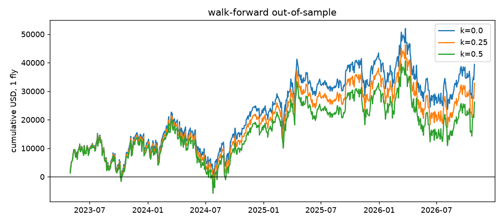

# Step 3 蝶式网格回测

样本：2022-05-02 到 2026-10-29，1118 个交易日，37 万笔模拟交易。样本外从 2023-05-01 开始，共 14 个窗口、869 个交易日。金额都是每天 1 组蝶，不做复利。全部表格在 `reports/step3_tables/`。

按上次的决定，网格去掉了“中心偏向零 gamma”。

## 结论

1. **Walk-forward 选参数没有带来价值**。样本外期望值 +38 美元/笔（k = 0.25），95% 区间 −64 ~ +141，不显著，最大回撤 2.9 万美元，选出来的参数还在不停换。
2. **回撤最小的是 14:00 入场、25 宽、持到结算**：同期 +52 美元/笔（区间 +0.3 ~ +103），最大回撤 1.4 万美元。**但这不能算显著**：它是看过 Step 2 之后，从 12 个固定方案里挑出的最好一个。同类方案（按风险选的 walk-forward，大多是下午 25 宽）样本外只有 +14 美元/笔，区间 −43 ~ +75。
3. **时间止损要避免**。边际集中在最后一段时间，提前离场的期望值全部转负。止盈止损几乎不改变结果。
4. **09:35 不开**：所有宽度的期望值都是负的。
5. **最强的“不开”条件是周四上午**：iron fly、75 宽、10:30 入场时，周四 −234，其他日子 +162，五年每年方向都一样。但它是在同一份数据里发现的，需要前瞻验证。
6. **用哪种结构下单比想象中重要**：iron fly 的成本明显低于 put fly，同样的 14:00、25 宽，k = 0.5 时 +34 对 +17。

## 成交与出场假设

- **中心**：入场分钟离现货最近的行权价。
- **成交**：入场 `V + k×H`，出场 `V − k×H`，H 是各腿半点差之和。k 取 0、0.25、0.5。
- **止盈止损**：用中间价判断，门槛是入场中间价的倍数。**在 t 分钟触发，用 t 之后第一个可用报价成交**，不用触发信号的那个报价。
- **时间止损**：在指定分钟成交。
- **持到结算**：按官方收盘价结算，没有出场点差和费用。
- **坏报价**：某分钟任一腿打了标，就跳过这一分钟的判断。
- **iron fly**：表示成等价的多头蝶价值，到期收益和门槛都与蝶相同，差异只在报价和费用。
- 半天交易日不交易。

## Walk-forward（样本外）

训练 12 个月，验证 3 个月，每 3 个月滚动。训练期选 k = 0.25 下期望值最高、且 k = 0.5 下仍为正的参数。每个窗口都选得出参数。

| k | 笔数 | 期望值（美元） | 95% 区间 | 总盈亏 | 胜率 | 盈亏比 | 最大回撤 |
|---|---|---|---|---|---|---|---|
| 0 | 869 | +45 | −56 ~ +149 | +39,397 | 59% | 0.75 | −28,359 |
| 0.25 | 869 | +38 | −64 ~ +141 | +32,770 | 59% | 0.74 | −29,054 |
| 0.5 | 869 | +30 | −71 ~ +133 | +26,143 | 59% | 0.74 | −29,749 |

各窗口选出的参数：

| 验证开始 | 选中 |
|---|---|
| 2023-05、2023-08、2023-11 | 10:30 / 75 / iron fly / tp2 |
| 2024-02、2024-05 | 10:30 / 75 / iron fly / sl50 |
| 2024-08、2024-11、2025-05 | 14:00 / 50 / iron fly / sl50 |
| 2025-02、2025-08 | 14:00 / 75 / iron fly / sl50 |
| 2025-11 | 12:00 / 75 / iron fly / tp2 |
| 2026-02 | 10:30 / 75 / iron fly / tp3 |
| 2026-05 | 10:30 / 75 / iron fly / sl50 |
| 2026-08 | 10:30 / 75 / iron fly / tp2 |

结构一直是 iron fly，宽度偏大，入场时间在 10:30、12:00、14:00 之间来回换，说明训练期的“最优”主要是噪声。按 EV 美元排序本身偏向大宽度，所以我又按“期望值 / 入场成本”选了一遍：参数集中到 25 宽，样本外 k = 0.25 时 +14 美元/笔，区间 −43 ~ +75，最大回撤 2.4 万，也不显著。

**曲线要点**：2024 年中几乎回到零，2026 年 3 月到 7 月从约 4.5 万回撤到约 1.6 万。2026 年的样本外是亏的（−16 美元/笔）。

## 固定方案对比

下表是 put fly、持到结算，不做任何选择，时间段与样本外相同。**这些方案是看过 Step 2 才关注的，所以只是同期对照，不是严格的样本外。**

| 入场 | 宽度 | k=0 | k=0.25 | k=0.5 | k=0.25 区间 | 胜率 | 最大回撤 |
|---|---|---|---|---|---|---|---|
| 09:35 | 25 | −24 | −36 | −48 | −88 ~ +17 | 39% | −38,369 |
| 09:35 | 50 | −14 | −30 | −47 | −126 ~ +71 | 52% | −49,683 |
| 09:35 | 75 | +16 | −7 | −29 | −134 ~ +118 | 56% | −59,462 |
| 10:30 | 25 | +3 | **−9** | −21 | −65 ~ +48 | 44% | −21,593 |
| 10:30 | 50 | +45 | +29 | +12 | −62 ~ +124 | 54% | −30,793 |
| 10:30 | 75 | +82 | +59 | +37 | −55 ~ +171 | 57% | −28,704 |
| 12:00 | 25 | +38 | +28 | +17 | −29 ~ +82 | 51% | −19,055 |
| 12:00 | 50 | +84 | +70 | +56 | −12 ~ +154 | 59% | −22,637 |
| 12:00 | 75 | +89 | +72 | +55 | −30 ~ +176 | 61% | −30,767 |
| **14:00** | **25** | **+68** | **+52** | **+36** | **+0.3 ~ +103** | **57%** | **−13,844** |
| 14:00 | 50 | +92 | +72 | +52 | −1 ~ +146 | 61% | −18,204 |
| 14:00 | 75 | +98 | +74 | +49 | −15 ~ +158 | 62% | −20,976 |

**对成交假设敏感**：10:30 / 25 在 k = 0 时为正、k = 0.25 就转负。09:35 的 75 宽 k = 0 为正，k = 0.25 转负。其余入场更晚的方案在 k = 0.5 下仍为正。

14:00 / 25 宽的平均风险约 1,280 美元/组，所以 +52 约合每笔 4%。这一行是表里 12 个方案中最好的，区间下限 +0.3 不足以说明它是真的，见结论 2。

**14:00 / 25 宽按年份（k = 0.25）**：2023 +4，2024 +102，2025 +27，2026 +59。四年都不亏，但 2023 年基本持平。

## 出场规则

iron fly，全部日子，k = 0.25，美元/笔。**这是样本内，仅供参考。**

| 规则 | 09:35 | 10:30 | 12:00 | 14:00 |
|---|---|---|---|---|
| 持到结算 | −32 | +46 | +56 | +69 |
| 止盈 2x | −26 | +44 | +60 | +73 |
| 止盈 3x | −31 | +47 | +56 | +69 |
| 止损 50% | −23 | +21 | +49 | +78 |
| 14:00 平 | −45 | −30 | −13 | |
| 15:00 平 | −55 | −27 | −24 | −10 |
| 止盈 + 止损 + 15:00 平 | −55 | −29 | −16 | −6 |

**时间止损全部把正边际变成负的**。蝶的边际集中在收盘前的时间价值衰减里，提前平掉就没有了，还多付一次点差和费用。这也说明，单纯的中间价路径基本是公平的，收益来自持到最后。

止盈 2x、3x 和持到结算差别很小：很多宽蝶的 2x 根本到不了。止损 50% 在 14:00 略好，在 10:30 明显变差：早入场的止损容易被盘中波动打掉。

## 结构

14:00 入场，持到结算，全部日子，美元/笔（样本内）：

| 宽度 | 结构 | k=0 | k=0.25 | k=0.5 |
|---|---|---|---|---|
| 25 | put fly | +53 | +35 | +17 |
| 25 | call fly | +55 | +37 | +19 |
| 25 | iron fly | +54 | +44 | +34 |
| 50 | put fly | +88 | +65 | +42 |
| 50 | call fly | +88 | +67 | +45 |
| 50 | iron fly | +88 | +79 | +70 |
| 75 | put fly | +90 | +65 | +39 |
| 75 | call fly | +92 | +68 | +44 |
| 75 | iron fly | +92 | +84 | +75 |

k = 0 时三者几乎一样，这也验证了模拟没有问题（理论上等价）。差异来自 put fly 的上翼和 call fly 的下翼是实值期权，点差更宽。

**注意**：这是按各腿 NBBO 算的。实际下组合单时，市场上的蝶和 iron fly 可能报价接近，差距可能没有这么大。可以用你的实盘成交记录核对。

## 什么条件下不开

以下都用 14:00 / 25 宽和 12:00 / 50 宽两个固定方案，以及样本外选中的序列，k = 0.25，从 2023-05 开始。VIX 高低只用过去 252 天判断，没有偷看未来。

| 条件 | 14:00 / 25 | 12:00 / 50 | 选中序列 | 证据强度 |
|---|---|---|---|---|
| 所有 09:35 入场 | | | | **强**：全宽度为负 |
| 周四上午入场 | | | −139 | **较强**，见下 |
| 前一日大跌 ≥ 1% | −164（−339 ~ +16） | −141 | −292 | **中**：三个序列都为负，都不显著 |
| 周三 14:00 | −65（−181 ~ +47） | | | 弱：可能与 FOMC 有关，不显著 |
| 零 gamma 之下，14:00 | −14（−105 ~ +76），之上 +88（+28 ~ +148） | | | 弱：上下差值的区间跨过 0，差距主要来自 2026 年，见 Step 2 |
| PCE 日 12:00 | | −283（−784 ~ +211） | −190 | 弱：样本 40 天 |
| 月度 opex，14:00 | +2 | | | 弱：约等于零 |

FOMC 下午：14:00 / 25 +52，12:00 / 50 +513，区间都极宽。**Step 2 的 FOMC 担心在这里没有得到支持**，样本只有 29 天，我不建议把它列入“不开”。

### 周四上午

iron fly、75 宽、持到结算，k = 0.25，美元/笔（全部日子）：

| 年份 | 10:30 非周四 | 10:30 周四 | 09:35 非周四 | 09:35 周四 |
|---|---|---|---|---|
| 2022 | +254 | −157 | −47 | −130 |
| 2023 | +172 | −430 | +16 | −483 |
| 2024 | +82 | −195 | +94 | −257 |
| 2025 | +155 | −214 | +10 | −112 |
| 2026 | +182 | −119 | +130 | −33 |

10:30 差值 −396 美元，95% 区间 −666 ~ −126，五年方向全部一致。我没有找到它的原因，周四上午没有固定的大事件，也不是某一天造成的（最差的几天分布在各年）。

### 用训练期学习“不开”

每个窗口只用训练期判断：选中的参数在某条件下亏钱（至少 10 笔），下一窗口就不开。

| 方案 | 笔数 | k=0.25 期望值 | 95% 区间 | 总盈亏 | 最大回撤 |
|---|---|---|---|---|---|
| 不过滤 | 869 | +38 | −64 ~ +141 | +32,770 | −29,054 |
| 学习过滤 | 734 | +99 | −3 ~ +203 | +72,403 | −14,566 |

过滤触发次数（14 个窗口）：周四上午 8 次，大跌后下午 4 次，低 VIX 且零 gamma 之下 2 次，FOMC 下午 0 次。

**这个结果看着很好，但不干净**：条件本身是我看过全样本的 Step 2 才列出来的，所以有数据窥探，真实效果会比这个小。

## 局限

- **样本外区间都很宽**。869 笔只能区分出每笔约 ±100 美元的差异。+52 美元的方案，也可能真实边际只有一半。
- **没有计入资金占用和保证金**，这留给 Step 4。
- **费率用今天的**，全样本一样。k 只影响点差，不影响滑点以外的执行问题。
- **分钟快照**：止损在一分钟内跳过去的风险只反映在下一分钟的报价上，实际可能更差。
- **没有测试多日连续亏损下的仓位**，回撤都是 1 组、不复利。
- **多重比较**：324 个参数组合。样本内榜单前列的数字（如 +99 美元）不可信，这正是强制 walk-forward 的原因。

## 全样本榜单（样本内，仅供参考）

k = 0.25 下前三名：10:30 / 75 / iron fly / tp2（+99），14:00 / 75 / iron fly / sl50（+98），14:00 / 75 / iron fly / tp2（+93）。完整榜单见 `reports/step3_tables/full_sample_in_sample.csv`。

## 产物

- `src/fly_grid.py`、`tests/test_step3.py`（10 项已知答案测试通过）
- `data/clean/fly_trades.parquet`
- `reports/step3_tables/`、`reports/figs/step3_oos_curve.png`

看完确认后我再进 Step 4。Step 4 的每日路径用现有的 `greeks_eod` 收盘报价就够，只需要补周五 15:00 下一周到期的报价快照（约 235 个）。“现货穿过中心 ±X 平仓”的成交价会用当天收盘价近似，到时候在报告里写明。
