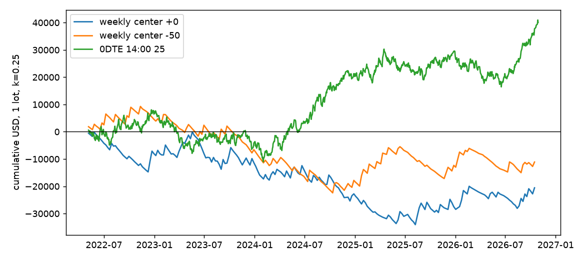

# Step 4 周蝶对比

样本：2022-05 到 2026-10，每周五 15:00 入场，220 周。金额是每个方案 1 组、不复利，默认 k = 0.25。全部表格在 `reports/step4_tables/`。

## 结论

**周蝶和 0DTE 蝶，哪个风险调整收益高，差多少？**

0DTE 更高。14:00、25 宽的 0DTE 蝶年化夏普 0.78，当前的周蝶持到到期是 −0.46，同一批 220 周里 0DTE 每周平均多赚 259 美元。但这个差距**差一点才显著**（每周差值 95% 区间 −17 ~ +534，夏普差值区间 −0.07 ~ +2.64）。

| 方案 | 每笔期望 | 95% 区间 | 胜率 | 最大回撤 | 夏普 | 夏普区间 |
|---|---|---|---|---|---|---|
| 周蝶 ATM，持到到期 | −93 | −279 ~ +100 | 28.6% | −33,969 | −0.46 | −1.52 ~ +0.44 |
| 周蝶 ATM−50，持到到期 | −50 | −225 ~ +127 | 22.3% | −31,694 | −0.27 | −1.41 ~ +0.65 |
| 两只一起 | −72 | −199 ~ +59 | 25.5% | −48,877 | −0.51 | −1.51 ~ +0.40 |
| 0DTE 14:00 / 25 put 蝶 | +36 | −9 ~ +81 | 55.7% | −19,044 | 0.78 | −0.16 ~ +1.71 |
| 0DTE 14:00 / 25 iron fly | +45 | 0 ~ +90 | 56.1% | −16,431 | 0.98 | +0.10 ~ +1.93 |

要点：

1. **周蝶 4.5 年回测没有正期望**。区间跨过 0，所以也不能说它一定亏，但没有证据证明它有边际。
2. **“周四收盘平”是最差的选择之一**。ATM 蝶每笔 −191（−298 ~ −78），显著为负，比持到周五结算少赚约 100 美元。
3. **现货穿越止损都显著为负**，但这里的成交价是近似的。
4. **0DTE 的数字偏乐观**：14:00 / 25 是事后挑的。更公平的比较见下。

## 比较要公平

上表的 0DTE 方案是 Step 3 里挑出来的。用同一段样本外时间（2023-05 起），并加上没有事后挑选的 walk-forward：

| 方案 | 每笔期望 | 95% 区间 | 总盈亏 | 最大回撤 | 夏普 |
|---|---|---|---|---|---|
| 0DTE 14:00 / 25 put 蝶（事后挑选） | +52 | +2 ~ +103 | +44,918 | −13,844 | 1.11 |
| 0DTE walk-forward 按风险选 | +14 | −42 ~ +72 | +12,495 | −24,049 | 0.28 |
| 周蝶 ATM | −104 | −320 ~ +126 | −17,737 | −33,969 | −0.51 |
| 周蝶 ATM−50 | −73 | −270 ~ +131 | −12,446 | −25,049 | −0.40 |

即使用最保守的 0DTE 口径，方向也不变：**0DTE 约为零到略正，周蝶约为零到略负。** 但这两组的区间有重叠，方向可信，幅度不确定。

## 出场规则

每笔期望（美元）：

| 出场 | ATM | ATM−50 | 说明 |
|---|---|---|---|
| 持到到期 | −93 | −50 | |
| 到期前一日收盘平 | **−191** | −63 | ATM 显著为负 |
| 3x 止盈（下一收盘成交） | −93 | −50 | 与持到到期一样，见下 |
| 3x 止盈（触发收盘成交） | −88 | −53 | 偏乐观，几乎没有差别 |
| 现货离中心 ±25 平 | −121 | −68 | 显著为负 |
| 现货离中心 ±50 平 | −157 | −66 | 显著为负 |
| 现货离中心 ±75 平 | −224 | −108 | 显著为负 |

- **3x 止盈几乎从不触发**：成本约 7–10 点，3x 约 21–29 点，日收盘很少到这个价，只有约 1% 的交易提前离场。
- **穿越止损的成交价用当天收盘价近似**，因为这一期限没有盘中报价。真实成交在穿越的那一分钟，可能更好也可能更差，这几行的绝对值只能作参考。但方向一致：离场后市场常常回来，又多付一次点差和费用。
- **最后一天的时间价值是周蝶的主要收益来源**，这和 Step 3 里 0DTE 不能提前平的结论是同一件事。

按年份，每笔期望：

| 方案 | 2022 | 2023 | 2024 | 2025 | 2026 |
|---|---|---|---|---|---|
| ATM 持到到期 | −236 | −68 | −233 | −97 | +178 |
| ATM−50 持到到期 | +134 | −227 | −230 | +112 | +31 |
| ATM 前一日平 | −389 | −262 | −308 | −126 | +137 |

**2026 年转正了**，这可能就是实盘感觉还不错的原因。但只有约 40 周，而 2022–2025 年的 ATM 全部为负。

## 路径（中位数）

| 距到期 | ATM 蝶价值（点） | 净 delta（股） | 净 theta（美元/天） | ATM−50 蝶价值 | 净 delta | 净 theta |
|---|---|---|---|---|---|---|
| 7 天（入场） | 9.40 | −3.2 | +70 | 6.90 | −5.2 | +38 |
| 4 天 | 9.30 | −4.4 | +106 | 6.45 | −6.0 | +52 |
| 3 天 | 9.25 | −4.6 | +112 | 6.62 | −5.9 | +57 |
| 2 天 | 8.70 | −7.2 | +77 | 6.30 | −5.7 | −6 |
| 1 天 | 8.55 | −6.6 | −25 | 5.60 | −5.8 | −48 |

（这里 1 组是 1 张翼 + 2 张身 + 1 张翼。）

- **价值中位数几乎不涨**：大多数周现货已经走开，theta 收不到，这就是胜率只有 22–29% 的原因。赚钱的是少数恰好落在附近的周，盈亏比 2–3 倍。
- **净 delta 是负的**：put 蝶入场时略看空。样本期 SPX 大涨，这是不利因素，也说明这个结果有一部分来自行情方向。
- **后两天 theta 中位数转负**：现货离开中心后，蝶站到了 gamma 的不利一侧。这是中位数，不是每周都如此。

## 资金占用

| 方案 | 平均占用 | 每笔收益 / 占用 | 持有 | 年化盈亏 / 最大回撤 |
|---|---|---|---|---|
| 周蝶 ATM | 968 | −9.6% | 7 天 | −0.14 |
| 周蝶 ATM−50 | 694 | −7.3% | 7 天 | −0.08 |
| 0DTE 14:00 / 25 put | 1,280 | +2.8% | 2 小时 | +0.47 |
| 0DTE 14:00 / 25 iron | 1,278 | +3.5% | 2 小时 | +0.68 |

- 周蝶一周只有一次机会，0DTE 一周五次。所以 0DTE 每天的亏损幅度和周蝶类似，但次数多，回撤反而更小。
- 周蝶入场占用的资金少，但持续 7 天。0DTE 只占 2 小时，其余时间资金空闲。
- 我没有计入保证金规则的差别：long fly 的占用基本就是付出的权利金。
- 0DTE 和周蝶每周盈亏的相关性只有 0.05。如果周蝶本身有正边际，两者搭配可以分散风险；现在的数据不支持这一点。

## 局限

- **220 周样本很小**，周蝶的区间约 ±190 美元。这份数据能看出“没有明显的正边际”，证明不了“一定亏”。
- **入场价格**是周五 15:00 的 NBBO，实盘入场时间和成交价会不同。
- **只测了 ATM 和 ATM−50 两个中心**，宽度 50。
- **日收盘路径**看不到盘中的高低点，3x 止盈的触发会被低估。
- **费用用今天的费率**。
- 跳过 4 笔（缺腿）和 2026-10-23 一周（到期超出数据）。

## 产物

- `src/fetch_thetadata.py`、`src/weekly_fly.py`、`tests/test_step4.py`（9 项已知答案测试通过）
- `data/raw/SPXW/quote_weekly_entry/`（223 个文件）、`data/clean/weekly_trades.parquet`、`weekly_path.parquet`
- `reports/step4_tables/`、`reports/figs/step4_curves.png`

